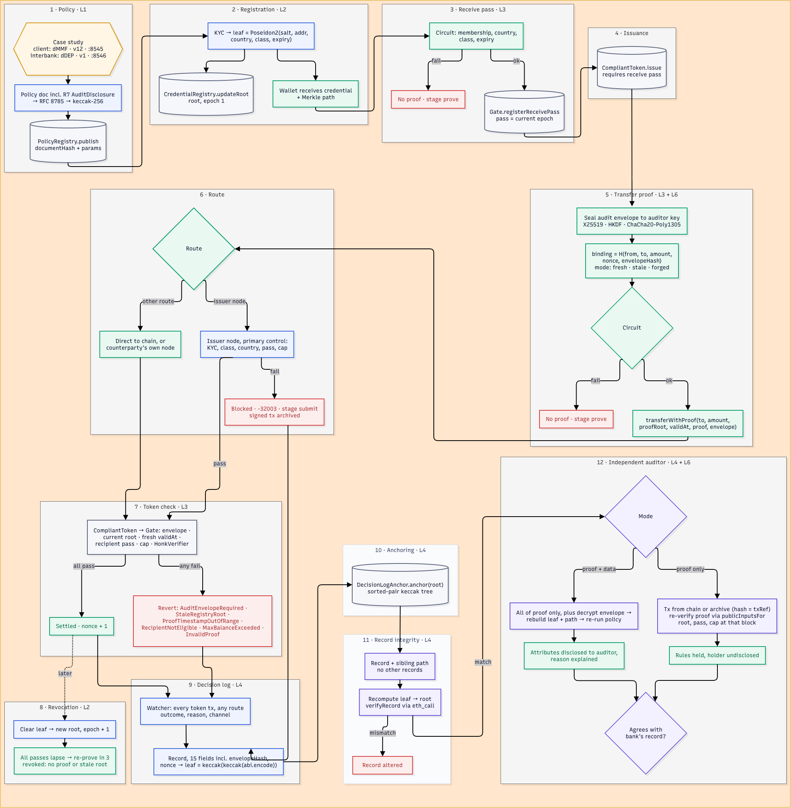
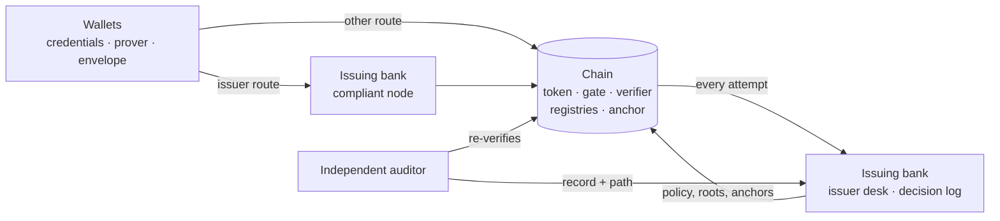

# Provable Compliance

**From enforcement to evidence.** A working proof of concept of the next evidence layer for a bank that already enforces its compliance rules on a public blockchain. The bank's compliant node remains the primary control. This layer adds an independent second check that travels with the asset, and a record that lets other institutions, supervisors and software agents verify the rules were followed, without revealing who the participants are.

It implements Layers 1 to 4 of the architecture in the accompanying note, *Making Compliance Provable on Public Blockchains*, end to end, with a first step of Layer 6: real zero-knowledge proofs, on-chain verification, credential revocation, a Merkle-anchored audit trail and an independent auditor that can check any decision from the proof alone or from the proof and its data. It runs one case study: interbank settlement of a tokenised deposit.

<!-- DEMO VIDEO: replace with a link or embedded GIF of the walkthrough -->
> **Demo video:** _coming soon_

<!-- ARCHITECTURE DIAGRAM: replace with docs/architecture.png -->
> **Architecture diagram:**
> 

```bash
npm start      # installs, builds, deploys and opens http://localhost:3000
```

First time? See **[HOW_TO_RUN.md](HOW_TO_RUN.md)** for a step-by-step guide.

---

## What it demonstrates

| Layer | In the note | In this demo |
|---|---|---|
| **1** | Rules defined in a form machines can read | The transfer policy is a structured document, canonicalised (RFC 8785) and fingerprinted (keccak-256). `PolicyRegistry` stores the fingerprint and the exact parameters every proof is checked against. |
| **2** | Eligibility issued as credentials | The issuer commits each participant's credential to a Poseidon2 Merkle tree. Only the root is on-chain; attributes stay in the holder's wallet. Revocation zeroes a leaf and publishes a new root. |
| **3** | Compliance proven at the moment of transfer | The issuing bank's compliant node screens every transfer it handles, as today. In addition, every transfer carries an UltraHonk proof, generated in the holder's wallet, that its credential is in the current registry and satisfies the active policy, and the **token** verifies it. The same rule therefore holds when a transfer reaches the chain through another institution's infrastructure. |
| **4** | A tamper-evident record of every decision | Every decision, including blocked attempts on any route, is a leaf in a keccak Merkle tree whose root is anchored on-chain. An auditor verifies one record against the root without seeing any other. |
| **6** (first step) | Regulator access to the underlying data | Each transfer carries a sealed audit envelope, encrypted to the auditor, whose hash is bound into the proof. The independent auditor can re-check a decision from the **proof only**, or from the **proof and its data**. |

## The case study: interbank settlement

| | |
|---|---|
| Asset | Tokenised deposits (`dDEP`) |
| Policy | `DDEP-INTERBANK` v1: licensed banks in CH, JP, SG, GB; 10m exposure cap per counterparty |
| Participants | Issuing Bank Treasury (CH), Partner Bank (JP), Regional Bank (SG, sanctioned midway), Payments Firm (regulated non-bank, never eligible) |
| The other route | The counterparty's own node |

The story: a compliant transfer settles; a sanctioned bank is stopped by the issuing bank's node and, through its own node, by the token; an ineligible firm cannot build a proof; a day of activity is anchored; and any decision is audited.

## Proof only, or proof + data

The auditor's two modes follow the distinction between validity rollups and rollups that also publish their data.

| | Proof only | Proof + data |
|---|---|---|
| What the auditor checks | The record matches an anchored root; the policy fingerprint; the transaction; the proof re-verifies against the registry root and policy it was built on; recipient pass and balance cap at that block | Everything in proof only, plus: decrypts the envelope, checks it describes this exact transfer, rebuilds the credential leaf and its path to the proof's root, and re-runs the policy on the attributes |
| What the auditor learns | That the rules held. Nothing about the holder | The holder's country, class, expiry and registry slot, and *why* a transfer was blocked |
| Analogy | Validity proof | Validity proof with data availability |

The envelope is `X25519 + HKDF-SHA256 + ChaCha20-Poly1305`, authenticated to the sender's address and carried in calldata. Because its hash is part of the proof's binding, the bank cannot swap the data after the fact and the holder cannot send data that differs from what was proven. For transfers the issuing bank's node held back, the bank archives the signed bytes; the auditor checks they hash to the recorded reference before using them.

## Architecture

The wallet, the bank and the auditor are separate processes with separate responsibilities: the bank never sees a holder's private inputs, and the auditor reads the chain directly, treating the bank's answers as claims to check.



### The circuit (`packages/circuits/eligibility`)

Written in Noir and proven with Barretenberg UltraHonk (EVM target, zero-knowledge). The holder proves:

> I know a credential `(salt, country, class, expiry)` for address `holder` whose Poseidon2 commitment is a leaf of the tree with root `registry_root`; `country` is in `allowed_countries`; `class` is set in `allowed_class_mask`; `expiry > now`; and this proof is bound to `binding`.

| Public input | Supplied by |
|---|---|
| `registry_root` | `CredentialRegistry.root()` |
| `allowed_countries[4]`, `allowed_class_mask` | `PolicyRegistry.active()` |
| `now` | the prover's `validAt`, bounded by the contract to the last hour |
| `holder` | `msg.sender` |
| `binding` | `keccak256(domain, chainId, token, from, to, amount, nonce, envelopeHash) mod p` |

Because `ComplianceGate` assembles the public inputs from contract state, a proof cannot be built against a policy, registry or transfer of the prover's choosing. The per-sender nonce prevents replay; the binding prevents redirecting a proof to another recipient, amount or envelope.

### Contracts (`packages/contracts/src`)

| Contract | Role |
|---|---|
| `PolicyRegistry` | Append-only policy versions: document hash plus machine parameters. |
| `CredentialRegistry` | Current credential-tree root and epoch. |
| `ComplianceGate` | ERC-3643-style compliance hook. Verifies transfer proofs and receive passes; enforces current root, proof freshness, recipient eligibility and balance cap. `publicInputsFor` lets an auditor rebuild the inputs of a historical proof. |
| `CompliantToken` | ERC-20 with `transfer`/`transferFrom` closed. Units move only via `transferWithProof(to, amount, root, validAt, proof, auditEnvelope)`. |
| `DecisionLogAnchor` | Anchors decision-log Merkle roots; `verifyRecord` checks single-record inclusion (OpenZeppelin `MerkleProof`). |
| `HonkVerifier` | Generated from the circuit by bb.js; linked against its external libraries at deploy. |

Recipients hold a **receive pass**: a proof against the current root, registered once per registry epoch. Any revocation changes the root and lapses every pass, so a revoked holder can no longer receive either.

### The policy (`packages/shared/src/policyDocument.ts`)

Rule types mirror existing token-compliance vocabularies (ERC-3643 modular compliance: `CountryAllow`, `MaxBalance`; CMTA RuleEngine: whitelist and sanctions-list rules), plus `AuditDisclosure`, which names who may open the envelope. Each rule declares where it is enforced: inside the ZK proof, by credential revocation, or by the token contract.

### Decision log

The bank records two sources of decisions: transfers its compliant node blocks before broadcast, and every token transaction observed on-chain (including failed ones from any sender, whose revert reason is recovered by replaying the call against the parent block). Each record carries the policy version and hash, registry root, proof hash, envelope hash and nonce. Leaves follow the OpenZeppelin StandardMerkleTree convention so verification is identical off-chain and on-chain.

## Repository layout

```
start.js                   one-command launcher (build, chains, deploy, services, UI)
packages/
  shared/                  policy model, case study, hashing, Merkle trees, bindings, audit envelope, types
  circuits/                Noir circuit, build script (ACIR + Solidity verifier), prover wrapper
  contracts/               Solidity sources, solc-js compile, deploy library, Hardhat config
apps/
  server/                  issuing bank (Fastify): issuer desk, compliant node, watcher, decision log
  wallet/                  participants' wallets (Fastify): credentials, proving, envelopes, submission
  auditor/                 independent auditor (Fastify): proof-only and proof + data re-checks
  web/                     React + Vite walkthrough (Framer Motion)
```

| Service | Port |
|---|---|
| Local chain | `:8546` |
| Bank | `:8789` |
| Wallets | `:8790` |
| Auditor | `:8791` |
| Web UI | `:3000` |

## Testing

```bash
npm test          # full suite, including real UltraHonk proofs verified on-chain
npm run test:fast # same flows with the circuit executed but proofs mocked (no trusted-setup download)
npm run typecheck
```

| Suite | Covers |
|---|---|
| `packages/shared` | Policy canonicalisation and fingerprint stability, parameter derivation for both policies, Merkle proofs for every tree size, tamper detection, envelope confidentiality, authentication and unlinkability |
| `packages/circuits` | TypeScript and Noir agree on roots; revoked, wrong-jurisdiction, wrong-class, expired, wrong-holder and tampered credentials are unprovable; a real proof verifies and a forged public input fails |
| `packages/contracts` | Public-input ordering matches the circuit; off-chain bindings match on-chain; envelope required and bound; append-only policies; issuance and transfer gating; replay and redirection; balance cap; stale root; proof freshness; historical public inputs; on-chain record verification |
| `apps/server` (e2e) | The full story across chain, bank, wallets and auditor: every route, every rejection reason, anchoring, on-chain audit, and every decision re-checked in both audit modes |

## Design notes and limits

This is a proof of concept, built to make the architecture concrete. Deliberate simplifications:

- **Local chains and development keys.** Accounts use Hardhat's public test mnemonic, and the auditor's demo key is in the source. Nothing here should hold real value.
- **Credential delivery.** Holders collect their credential over an unauthenticated local API; production would use an authenticated wallet channel and holder-generated secrets.
- **One auditor key.** Production would use a key held by the supervisor or split across parties (threshold decryption), which is the rest of Layer 6.
- **Single issuer per case.** Cross-issuer credentials and policy migration belong to Layer 8.
- **Amounts and addresses are public.** Hiding them is Layer 5 (for example ERC-7984); discussed in the note, not built.
- **Revocation lapses all passes.** Simple and safe; a production design would use an append-only registry with a separate revocation accumulator so honest holders are not forced to re-prove.
- **Gas.** On-chain UltraHonk verification costs a few million gas per proof, which is why the note suggests starting with issuance, redemption and new counterparties.

## Stack

Noir 1.0 · Barretenberg (bb.js 5.3, UltraHonk) · Solidity 0.8.28 · OpenZeppelin Contracts 5 · Hardhat (local node) · viem · noble (curves, ciphers, hashes) · Fastify · React 19 · Vite · Framer Motion · TypeScript

---

Pranav Shinde · October 2026 · MIT licence
